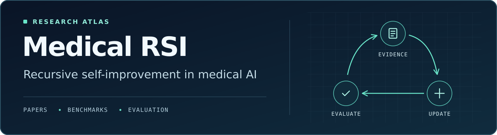

# Awesome Medical Recursive Self-Improvement 

A curated research index for **self-improving medical and biomedical AI**. Find papers by what they update, see what feedback drives the update, and choose benchmarks that can test whether gains carry over to new cases.

[**Browse the paper catalog**](docs/papers.md) · [**Find datasets and benchmarks**](docs/benchmarks.md) · [**Read the classification guide**](docs/taxonomy.md) · [**Contribute**](CONTRIBUTING.md)

## Start here

| If you want to… | Start with |
| --- | --- |
| Understand the field | [The Path to Self-Evolving Clinical Systems](docs/papers.md#the-path-to-self-evolving-clinical-systems) for a field overview, then the [classification guide](docs/taxonomy.md) for reading claims about improvement. |
| Compare how agents improve | [MedRSI](docs/papers.md#medrsi) for capability validation across cohorts, [MACRO](docs/papers.md#macro) for tool discovery, and [BaT](docs/papers.md#bat) for rubric-guided post-training. |
| Design an evaluation | [MedAgentBench](docs/benchmarks.md#interactive-environments) for EHR tool use, [U-MRG-14K](docs/benchmarks.md#training-and-grounding) for visual grounding, and [MEDEC](docs/benchmarks.md#reliability-and-safety) for clinical-note error detection. |

## How to read the labels

| Label | What changes |
| --- | --- |
| **Inference** | The answer, plan, or other state within the current case or task. |
| **Persistent** | Weights, memory, tools, or workflow state carried into future cases or tasks. |
| **Meta-update** | Part of the procedure that generates, evaluates, or adopts future updates. See the catalog notes for what each paper actually evaluates. |
| **Resource** | A survey, benchmark, verifier, dataset, or technique relevant to designing or evaluating improvement. |

The labels describe the mechanism and evidence in each paper. For a recursive claim, look for a changed improvement procedure that produces a better subsequent update on fresh tasks under comparable budgets. The [classification guide](docs/taxonomy.md) explains what to check.

## Browse by topic

| Topic | What you’ll find |
| --- | --- |
| [Surveys](docs/papers.md#surveys) | Overviews of medical agents, self-evolving systems, and hallucination. |
| [Model self-improvement](docs/papers.md#model-self-improvement) | Reinforcement learning, verifiable reasoning, and test-time adaptation. |
| [Data self-improvement](docs/papers.md#data-self-improvement) | Synthetic reasoning data, refinement, and automated annotation. |
| [Memory and knowledge](docs/papers.md#memory-knowledge-self-improvement) | Experiences, procedural heuristics, and clinical knowledge stores. |
| [Tools, skills, and workflows](docs/papers.md#tool-skill-workflow-self-improvement) | Tool discovery, skill synthesis, and experience-guided tool use. |
| [Evaluators, verifiers, and feedback](docs/papers.md#evaluator-verifier-feedback-improvement) | Clinical verifiers, error diagnosis, and reflection loops. |
| [Environment-driven improvement](docs/papers.md#environment-driven-self-improvement) | Learning from interaction in clinical and biomedical simulations. |
| [Recursive meta-improvement](docs/papers.md#recursive-meta-improvement) | Candidate systems and baselines for testing whether the update procedure improves. |
| [Safety, reliability, and governance](docs/papers.md#safety-reliability-governance) | Hallucination, grounding, clinical error detection, and lifecycle governance. |
| [Datasets and benchmarks](docs/benchmarks.md) | Training data, safety evaluations, and executable environments. |

## Contribute and cite

Read the [contribution guide](CONTRIBUTING.md) to propose a resource or correct a citation. Cite individual papers for their findings and use the [repository citation](CITATION.cff) when referencing the collection. For a reproducible snapshot, include the commit URL and the date you accessed it.

Research and education resource. Third-party papers, code, and datasets retain their own licenses and access terms.
